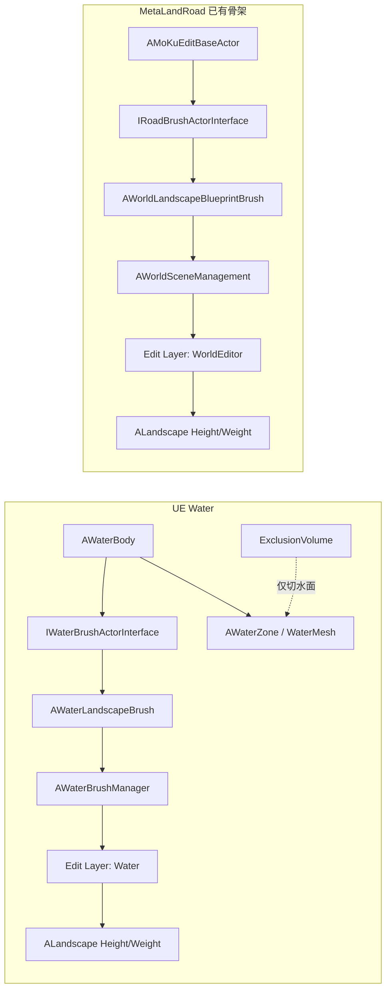

# 道路影响地形高度 / 材质 — 方案（对照 Water）

> 状态：地形方案待开工。切面三角缺口已先修（见下）。

---

## 一、切面三角缺口（已修 2026-08-06）

### 现象
橙选弯道路段在 section 边界出现三角撕裂；近路口处偶发同类缺口。

### 已落地修复（`GenerateCombinedLaneDynamicMesh`）

| 改动 | 作用 |
|------|------|
| **Shared breaks** | Left/Right 共用全部 section `SOffset` 断点，双侧在同一 `S*` 有缝环 |
| **Transition cap** | 相邻 face span 外轮廓不一致时，在 `S*` 补截面过渡三角带 |
| **零宽 skip** | 阈值从 1cm² 收到 0.01，避免 tip 混宽误丢 quad |

### 路口接缝 / 分叉针裂（已修 2026-08-06）

| 改动 | 作用 |
|------|------|
| **Mouth overlap ~28cm** | `GetJunctionMeshGenerationSpans` 路 mesh 伸进 hub gap，盖住 T 口黑缝 |
| **Edge lane clamp** | 2 点 CS 不再拿对侧外缘当 Inner（整口条带 → 分叉针裂） |
| **Acute crotch** | 长弦锐角强制 straight；sag/mid-width/交叉轨更严 |

---

## 二、Water vs MetaLandRoad 对照



| 维度 | Water | MetaLandRoad 现状 | 差距 |
|------|-------|-------------------|------|
| 契约 | `IWaterBrushActorInterface` | `IRoadBrushActorInterface` | 已对齐 |
| Brush | `AWaterLandscapeBrush` | `AWorldLandscapeBlueprintBrush` | 已对齐 |
| Manager | `AWaterBrushManager::RenderLayer_Native` | `AWorldSceneManagement::RenderLayer_Native` | 管线在，需验通 |
| Edit Layer | `"Water"` | `"WorldEditor"` | 需 Landscape **Enable Edit Layers** |
| Height | `FWaterBodyHeightmapSettings` + JumpFlood DF | `FSplineRoadHeightmapSettings` + `UFloodComponent2D` | 需参数默认值与道路截面宽度对齐 |
| Weightmap | `TMap<FName, FWaterBodyWeightmapSettings>` + `UpdateAffectedWeightmaps` 填层名 | `RoadBodyWeightmapSettings` 有；**`UpdateAffectedWeightmaps()` 空实现** | **明日必补** |
| 影响开关 | `AffectsLandscape()` | 有 `bAffectsLandscape`，但 **`AffectsLandscape()` 恒 true**（未读开关） | 明日改成读 `bAffectsLandscape` |
| 水面特有 | WaterZone / ExclusionVolume | 无（道路不需要） | 不做 |
| 备选路径 | — | MetaRoad `UpdateLandscape` spline 层；`ULandscapeExtensionComponent` stub | 本阶段不走 |

**结论：不要重写一套地形系统。** 走已 fork 的 Water 刷笔路径，把「道路 → WorldEditor 层高度/权重」跑通并产品化。

---

## 三、明日目标（可验收）

### Goal
选中/编辑一条 MoKu 道路后，相交 Landscape 的 **WorldEditor** 层自动：
1. **压低/抬高原地高度**（路床 + 路肩 falloff）
2. **刷入道路材质权重层**（至少 1 个 asphalt / road layer）

### 非目标（明日不做）
- 切面三角洞 / junction Fig1 大改
- ExclusionVolume、WaterZone 对等物
- MetaRoad Pro spline-layer 双管线
- `ULandscapeExtensionComponent` 复活

### 验收清单
- [ ] Landscape 已 Enable Edit Layers；存在 `WorldEditor` 层
- [ ] 放置/移动/改宽道路 → 高度带随路更新（可调 falloff）
- [ ] 至少 1 个 weightmap 层被刷上（Details 可见层名）
- [ ] `bAffectsLandscape` / `AffectsLandscape()` 关闭后不再更新
- [ ] Output Log 有 brush update / RenderLayer 痕迹（或等价 on-screen）

---

## 四、实施步骤（建议顺序）

### Day 1 — 打通与对齐 Water

1. **前提检查文档化**  
   Landscape → Enable Edit Layers；WorldEditor brush 已 spawn（`MetaLandRoadModule` / EditorMode）。

2. **补 `UpdateAffectedWeightmaps()`**（对齐 Water）  
   从所有 tracked `IRoadBrushActorInterface` 收集 `RoadBodyWeightmapSettings` 的 `FName` → 写入 brush `AffectedWeightmapLayers`；`SetCanAffectWeightmap(true)`。  
   文件：`WorldLandscapeBlueprintBrush.cpp`。

3. **`AffectsLandscape()` 读 `bAffectsLandscape`**  
   `MoKuEditBaseActor.h` 当前恒 `true`，开关无效。

4. **验事件链**  
   `AMoKuEditBaseActor` 改 spline / 宽度 / 设置 → `Broadcast` → `OnRoadBrushActorChanged` → `RequestLandscapeUpdate()` → `AWorldSceneManagement::RenderLayer_Native`。  
   断点或 log：actor 列表、RT 尺寸、是否 early-out。

5. **高度默认参数**  
   用道路半宽驱动 falloff width；`FSplineRoadHeightmapSettings` 给可用默认（blend / falloff / 深度）。对照 Water `FWaterBodyHeightmapSettings`。  
   文件：`SplineRoadBasicSettings.h`、`MoKuEditBaseActor`、`WorldEditorSettings`。

6. **材质权重**  
   Project Settings / WorldEditorSettings 指定默认 layer 名（如 `Road` / `Asphalt`）；Landscape Material 需有同名 Layer Info。  
   道路 actor 默认写入一条 `RoadBodyWeightmapSettings`。

7. **捕获几何**  
   确认 scene capture 用的是道路 `DynamicMeshComponent`（或等效宽度 mesh），宽度与真实路宽一致；窄捕获会导致“只影响中心一条线”。

### Day 2+ — 打磨（地形稳定后再回头修切面）

- 性能：合并 dirty、throttle `RequestLandscapeUpdate`
- 路口：junction cover 是否参与 brush（可选第二阶段）
- 切面 P0：section transition cap（见第一节 backlog）

---

## 五、关键文件

### Engine Water（参考）
- `Engine/Plugins/Experimental/Water/.../WaterBrushActorInterface.h`
- `.../WaterLandscapeBrush.cpp`（`SetTargetLandscape` / `UpdateAffectedWeightmaps`）
- `.../WaterBrushManager.cpp`（`RenderLayer_Native`）
- `.../WaterBodyHeightmapSettings.h` / `WaterBodyWeightmapSettings.h`

### MetaLandRoad（改这里）
- `Plugins/MetaLandRoad/.../RoadBrushActorInterface.h`
- `.../WorldLandscapeBlueprintBrush.cpp` ← weightmap 列表
- `.../EditSplineRoadInfo.cpp` ← `RenderLayer_Native`
- `.../MoKuEditBaseActor.h` ← height/weight 设置、`AffectsLandscape`
- `.../SplineRoadBasicSettings.h`
- `.../WorldEditorSettings.cpp` ← 材质路径
- `.../MetaLandRoadModule.cpp` ← brush 自动 spawn

---

## 六、风险与依赖

| 风险 | 缓解 |
|------|------|
| Landscape 未开 Edit Layers | 启动时检测 + 提示 |
| Landscape Material 无对应 Layer | Settings 校验 + 文档默认名 |
| 捕获 mesh 与路宽不一致 | 用 layout 半宽生成 capture proxy 或保证 DM 全宽 |
| 与 Water 同图抢层 | 分层 `Water` vs `WorldEditor`，已隔离 |
| JumpFlood / RT 失败静默 | RenderLayer 打 BEGIN/END log |

---

## 七、明日开工第一刀

```
1. Landscape Enable Edit Layers + 确认 WorldEditor brush 存在
2. 实现 UpdateAffectedWeightmaps（抄 Water）
3. 给默认道路挂 1 条 weightmap + 合理 height falloff
4. 拖一条路看高度带；再开 weightmap 可视化验材质层
```

切面三角洞记入后续「框架/bug」批次，不阻塞地形方案。
